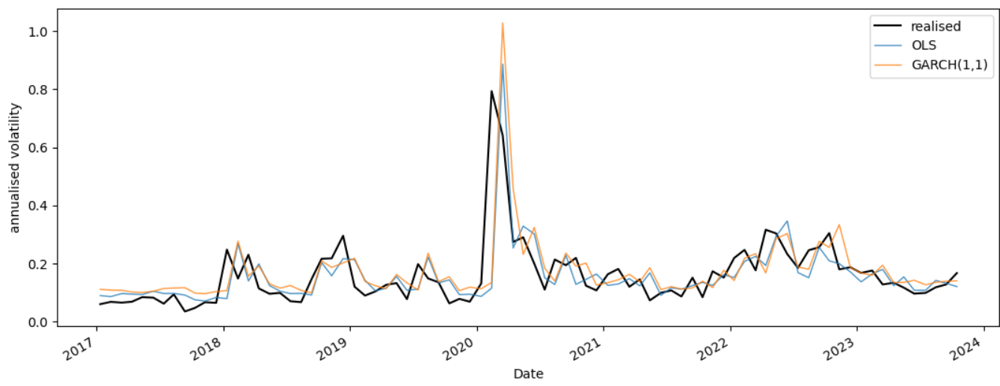

# Forecasting 21-Day Realized Volatility of the S&P 500

Comparison of naive persistence, a HAR-style regression, GARCH and ML Regression Models (LR & SVR) for forecasting the realized volatility of the
S&P 500 index 21-days ahead.

**[Full technical note (PDF)](volatility_forecasting_note.pdf)** ·
**[Notebook](sp500-volatility-forecasting.ipynb)**

## Question

Can machine-learning regressions improve out-of-sample forecasts of index
volatility relatively to persistence and classical volatility models 
at a 21-trading-day horizon?

The target at date *t* is the annualized standard deviation of the **next** 21
daily log returns. Predictors use returns up to *t* only, so no data leakage.
## Models

**Notation.** $`r_t = \ln(P_t/P_{t-1})`$ is the daily log return. All forecasts target the annualized volatility of the next 21 daily returns:

```math
RV_{t+1:t+21} = \sqrt{252} \cdot \mathrm{sd}(r_{t+1},\dots,r_{t+21})
```

### 1. Naive persistence
Next month's volatility equals last month's:

```math
\hat\sigma_t = RV21_t = \sqrt{252} \cdot \mathrm{sd}(r_{t-20},\dots,r_t)
```

### 2. HAR-style regression
Linear regression on volatility at three horizons (day, week, month), fitted by OLS:

```math
RV_{t+1:t+21} = \alpha_0 + \alpha_1 \sigma^{(1)}_t + \alpha_2 \sigma^{(5)}_t + \alpha_3 RV21_t + \varepsilon_t
```

with $`\sigma^{(1)}_t = \sqrt{252} \lvert r_t \rvert`$ and $`\sigma^{(5)}_t`$ its 5-day average.

### 3. GARCH(1,1)
Daily conditional variance of returns, fitted by maximum likelihood:

```math
r_t = \sigma_t z_t, \quad z_t \sim \mathcal{N}(0,1), \qquad \sigma_t^2 = \omega + \alpha r_{t-1}^2 + \beta \sigma_{t-1}^2
```


The 21-day forecast sums the daily variances and annualizes:

```math
\hat\sigma_t = \sqrt{\frac{252}{21} \sum_{h=1}^{21} \mathbb{E}_t[\sigma^2_{t+h}]}
```

### 4. Linear regression (OLS)

```math
RV_{t+1:t+21} = \beta_0 + \beta^\top x_t + \varepsilon_t
```

$`\beta`$ minimizes the sum of squared errors. Features are standardized on the training sample only.

| Feature | Definition | Intuition |
|---|---|---|
| `RV21` | $`\sqrt{252} \cdot \mathrm{sd}(r_{t-20},\dots,r_t)`$ | Current monthly volatility; volatility is persistent |
| `LAG1`, `LAG5`, `LAG21` | RV21 one day, one week and one month ago | Whether volatility is rising or falling, and how fast it decays |
| `P/SMA_20` | $`P_t / \mathrm{mean}(P_{t-19},\dots,P_t)`$ | Price vs. its 1-month average: below 1 means a recent drop |
| `P/SMA_50` | $`P_t / \mathrm{mean}(P_{t-49},\dots,P_t)`$ | Same over about 2.5 months: medium-term trend |
| `RSI14` | $`100 - 100/(1 + U/D)`$, with U, D the average up and down moves over 14 days | Momentum from 0 to 100: low means recent selling pressure |

**leverage effect**: volatility tends to rise after prices fall. That is why they are negatively correlated with the target (−0.42 for `P/SMA_20`, −0.51 for `P/SMA_50`).

### 5. Support Vector Regression (linear kernel, C = 10, ε = 0.01)
Same linear prediction as OLS, $`\hat\sigma_t = w^\top x_t + b`$, but errors smaller than epsilon are ignored and errors penalized linearly (so less sensitive to extreme dates)

```math
\min_{w,b} \frac{1}{2}\lVert w \rVert^2 + C \sum_t \max\left(0, \lvert RV_t - w^\top x_t - b \rvert - \varepsilon\right)
```


## Evaluation design


- **Walk-forward, expanding window.** The model is refitted every 21 trading days
  and predicts the following block.
- **21-day embargo.** Training stops 21 days before the forecast origin, so no
  training target overlaps the test block.
- **QLIKE on variances** as the primary loss, alongside RMSE, R² and R² relative
  to the naive and HAR benchmarks.
  $$\text{QLIKE}_t = x_t - \ln x_t - 1 \ \ge 0 \quad $$
  with $x_t = RV_t^2 / \hat\sigma_t^2$.

## Results

<!-- TODO: paste the final table from the notebook -->

| Model | QLIKE | RMSE | R² | R² vs naive | R² vs HAR | Corr |
|---|---:|---:|---:|---:|---:|---:|
| GARCH(1,1) | **0.6607** | 0.1044 | 0.1409 | −0.0148 | −0.0968 | 0.5863 |
| HAR-style | 0.7535 | 0.0997 | 0.2167 | 0.0748 | 0.0000 | 0.5919 |
| OLS | 0.8223 | 0.0962 | 0.2707 | 0.1385 | 0.0689 | **0.5982** |
| Naive | 0.8514 | 0.1036 | 0.1534 | 0.0000 | −0.0808 | 0.5784 |
| SVR (selected) | 0.8613 | **0.0956** | **0.2792** | **0.1486** | **0.0798** | 0.5961 |

*82 non-overlapping 21-day forecasts, 2017-01-11 to 2023-10-16. Sorted by QLIKE (lower is better); best value per column in bold.*

**The ranking depends on the loss.**
GARCH(1,1) has the lowest QLIKE, yet its squared error is essentially that of
naive persistence. Conversely, SVR and OLS
have the lowest RMSE and the highest $R^2$, but QLIKE values close to
persistence (SVR is in fact the worst of the five on this metric). All five models have almost the same correlation with realized
volatility (0.58--0.60): they contain similar information and differ mainly in
the level and asymmetry of their errors.



## Running it

```bash
git clone https://github.com/<user>/sp500-volatility-forecasting.git
cd sp500-volatility-forecasting
pip install -r requirements.txt
jupyter lab notebooks/sp500_volatility_forecasting.ipynb
```


## Limitations
- From 2017-01-11 to 2023-10-16 is about 6.76 years, roughly 1,703 trading days at 252 per year, and 1703 / 21 ≈ 81. 81 forecasts is maybe too few to evaluate models.

## Repository layout

```
notebooks/   analysis notebook
report/      technical note.
figures/     figures used by the note and README.
```

## Author
Ayoub Ben Othman
Email: ayoub.ben-othman@polytechnique.edu

